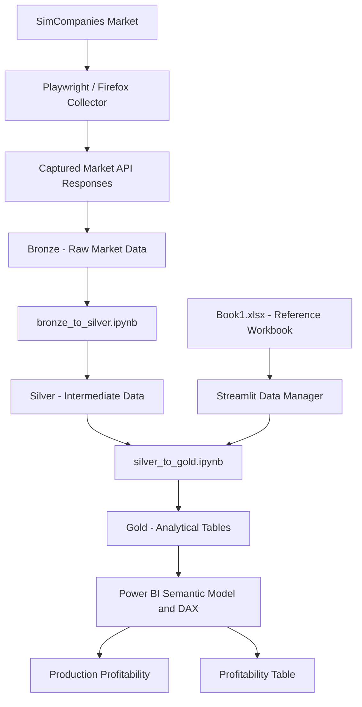
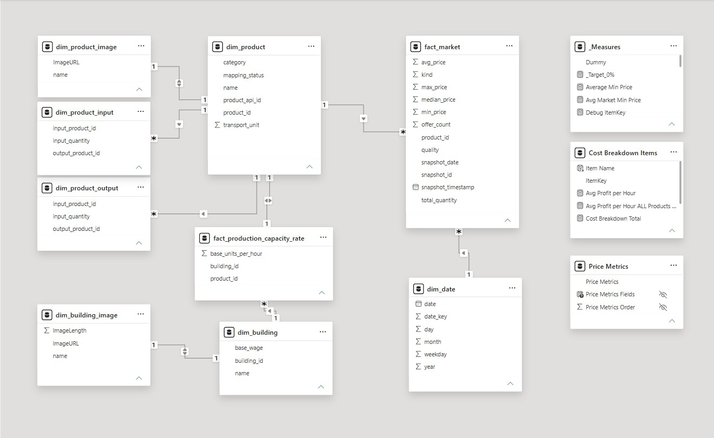

# SimCompanies — Market & Production Profitability Analytics

An end-to-end data engineering and business intelligence project designed to support production decisions in **SimCompanies**. It combines market snapshots with product recipes, production capacity and building costs to compare production costs and estimate potential profitability across products and quality levels.

The project is currently a **proof of concept (PoC)**. Its present scope focuses on market-price analysis and production profitability; demand estimation and fully automated production recommendations are planned extensions.

## Project overview

The goal is to help players assess **what may be profitable to produce under the currently observed market conditions**. The report brings together market prices and production inputs so users can explore questions such as:

- Which products and quality levels currently show higher estimated profit per unit or per hour?
- How do minimum, maximum, average and median market prices change over time?
- How do recipe ingredients and labour contribute to production cost?
- Are the required ingredients currently represented by available market-price data?

The calculations are estimates based on the collected market snapshots and the currently maintained reference data. They should not be interpreted as guaranteed sales or realised profit.

## Key features

### Currently implemented

- Browser-based collection of market snapshots and captured market API responses.
- Reference-data maintenance through a Streamlit application backed by an Excel workbook.
- Local data processing with Python and PySpark, organised into Bronze, Silver and Gold layers.
- Analytical model combining market snapshots, products, buildings, production capacity and product recipes.
- Product- and quality-level exploration in Power BI.
- Production cost calculations covering recipe ingredients and labour.
- Profit per unit, profit per hour and margin calculations based on available market prices and production capacity.
- Market-price history analysis using minimum, maximum, average and median price metrics, with listed quantity and offer-count context.
- Production-availability checks based on the selected production option and the availability of required ingredient prices in the collected data.

### Planned / under consideration

- Company configuration, including owned buildings and executives.
- Production recommendations based on the player's company setup and available production options.
- More detailed ingredient and recipe drill-down.
- Retail sales analysis, including estimated sales volume and revenue over time.
- Modelling the effects of the game's Normal, Boom and Recession phases.

## Data pipeline

The project combines two input streams: market observations collected from the game and reference data maintained locally.

1. **Market collection** — a Python collector uses Playwright with Firefox to interact with the market interface and capture the market API responses used to create snapshots.
2. **Reference data management** — `src/app/app.py` provides a Streamlit interface for maintaining reference data in the local `data/source/Book1.xlsx` workbook (for example, products, buildings, recipes and production-related information).
3. **Bronze layer** — raw collected market data is stored under `data/bronze/` before downstream transformations.
4. **Silver transformation** — `src/transformation/bronze_to_silver.ipynb` processes the Bronze market data into the intermediate Silver layer.
5. **Gold transformation** — `src/transformation/silver_to_gold.ipynb` prepares the analytical tables stored under `data/gold/`.
6. **Reporting** — Power BI uses the prepared data and DAX measures to calculate and visualise market and production metrics.



The layer names reflect the current repository and notebook workflow. The Silver stage is an intermediate transformation stage; the project is still being refined and does not claim that every source-data quality issue or missing reference has been resolved.

## Data model

The Power BI data model combines market, production and product reference data to support product-level profitability analysis.



The Power BI model combines market and production information to calculate ingredient cost, labour cost, total production cost and profitability measures. The detailed table and column definitions belong in the [Data Dictionary](docs/data_dictionary.md).


## Power BI report

### Production Profitability

A product-level view for analysing one selected product, quality and production building.


### Profitability Table

A comparative view for exploring product and quality combinations. It supports filtering by category, quality and production building, and comparing production cost, market price, profit per unit, margin and profit per hour. Conditional formatting helps distinguish results above and below the selected comparison average.


### Planned dashboard extensions

Future iterations are expected to let users describe their own company setup, including production buildings and executives, and use that configuration to compare or recommend more profitable production options. More detailed ingredient-level exploration and cost drill-downs are also being considered.

## Technology stack

| Area | Technologies |
|---|---|
| Programming and data processing | Python, pandas, PySpark (local execution) |
| Market collection | Playwright, Firefox, browser-based API response capture |
| Reference-data application | Streamlit, Excel / openpyxl |
| Image processing | Pillow |
| Analytics and reporting | Microsoft Power BI, DAX, Power Query (M), data modelling |
| Development workflow | Python scripts, Jupyter notebooks, Git |

## Repository structure

[Repository Structure Tree](docs/repository_structure.md)

## Getting started

### Prerequisites

- Python 3.10 or a compatible Python version for the installed PySpark release.
- A Java runtime supported by the installed PySpark version, configured for local Spark execution.
- Firefox browser binaries installed through Playwright.
- The local reference workbook and any source data required by the selected script or notebook. These files are not included in this repository.

### 1. Clone the repository and create an environment

```bash
git clone <repository-url>
cd SimCompanies

python -m venv .venv
```

Activate the virtual environment:

```powershell
# Windows PowerShell
.venv\Scripts\Activate.ps1
```

```bash
# macOS / Linux
source .venv/bin/activate
```

### 2. Install Python dependencies

```bash
python -m pip install --upgrade pip
python -m pip install -r requirements.txt
```

Install the Firefox browser used by Playwright:

```bash
python -m playwright install firefox
```

### 3. Prepare local data

Create or populate the required local data folders and place the reference workbook at:

```text
data/source/Book1.xlsx
```

Market snapshots and image assets are collected or generated locally. The `data/` directory is excluded from version control, so the workbook, snapshots and downloaded images must be supplied or generated separately.

### 4. Run the Streamlit reference-data manager

From the repository root:

```bash
streamlit run src/app/app.py
```

The application is used to maintain the reference workbook. It is separate from the market collection and Spark transformation scripts.

### 5. Run collection and transformation scripts

Python ingestion and utility scripts are run directly from the repository root, after checking any path or collection settings in the relevant file. They are separate utilities; run only the steps needed for the data you want to refresh.

```bash
# Collect market snapshots
python src/ingestion/market_collector.py

# Download building and product images (when needed)
python src/ingestion/download_images.py
python src/ingestion/download_images_products.py

# Run the image-mapping utility (when updating image mappings)
python src/transformation/map_images.py
```

The main market-data transformation notebooks are executed in this order:

1. `src/transformation/bronze_to_silver.ipynb`
2. `src/transformation/silver_to_gold.ipynb`

The additional notebooks `map_images.ipynb` and `product_mapping.ipynb` support image and product mapping tasks; they are not required for every market-data refresh.

Open the notebooks in VS Code or Jupyter using the environment created above. If the notebook kernel is not detected, register the environment:

```bash
python -m ipykernel install --user --name simcompanies --display-name "Python (SimCompanies)"
```

### 6. Open and refresh the Power BI report

Open `power_bi/Dashboard.pbix` in Power BI Desktop. Configure the Power Query parameter `pProjectRoot` to the local absolute path of the repository root, then refresh the queries. The report requires the corresponding local data files and image folders.

## Documentation

- [Architecture](docs/architecture.md) — pipeline stages and project architecture.
- [Data Dictionary](docs/data_dictionary.md) — analytical tables and their fields.
- [Repository Structure](docs/repository_structure.md) — project file structure.

## Limitations and future improvements

This project is a proof of concept. Its current metrics are based on collected market listings and maintained production reference data; several important parts of the in-game economy are not yet modelled.

- **Demand and order-book data:** the current collection process does not provide the full order book or reliable realised-sales data. Listed supply and prices cannot, on their own, establish how much of an item can actually be sold per day or the true demand curve.
- **Retail modelling:** retail sales and revenue calculations are not implemented yet. The relationship between price, demand and sales volume is non-linear and will require additional investigation and validation rather than a simple fixed multiplier.
- **Economic phases:** the currently collected market data represents the Normal phase. Boom and Recession phases, and their effects on production, retail and stock behaviour, are not yet included.
- **Collection frequency and access constraints:** frequent browser/API collection may cause rate limiting or account restrictions. Collection frequency therefore needs to remain conservative and comply with the game's applicable rules.
- **Reference-data coverage:** some products, recipes or production options are not fully populated. A missing input in the model can indicate incomplete reference or market data, not necessarily that the item cannot be produced in the game.
- **Production optimisation:** the current report compares estimated profitability for selected products and production buildings. It does not yet optimise a complete company setup using owned buildings, executives, demand constraints and retail sales.

Planned work includes improving reference-data coverage, adding company and executive configuration, investigating retail and demand modelling, and extending the report towards production recommendations.

## Data, assets and scope

Raw market data, the `Book1.xlsx` workbook and downloaded game images are not included in the public repository. The project code and documentation are provided to demonstrate the collection, transformation, modelling and reporting workflow. SimCompanies is a third-party game; no ownership of its name or game assets is claimed.

---

*This repository represents an evolving personal project and proof of concept. Features described as planned or under consideration are not part of the current implementation.*
